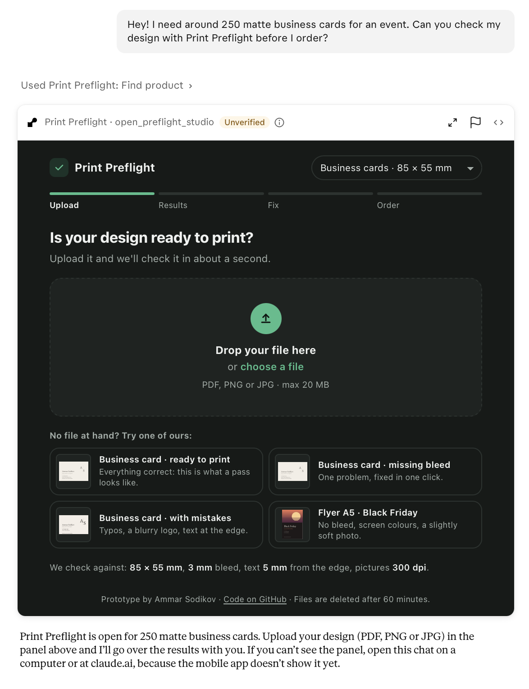
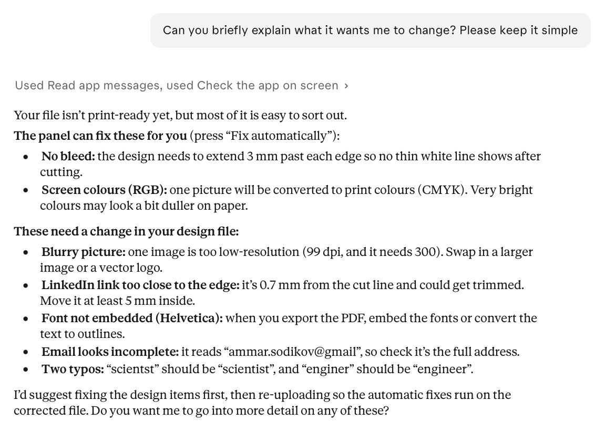
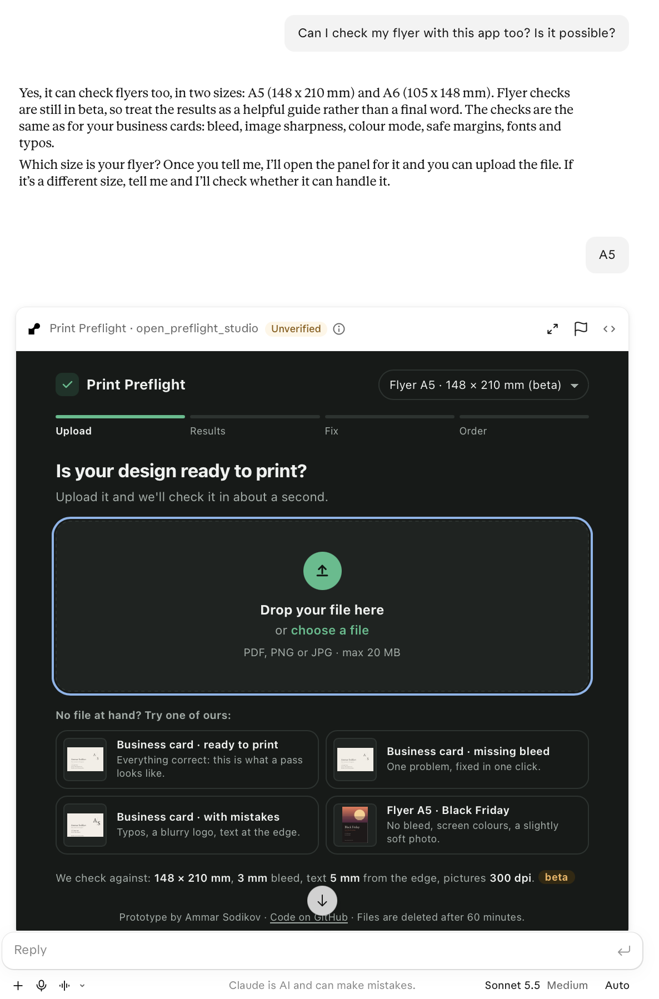
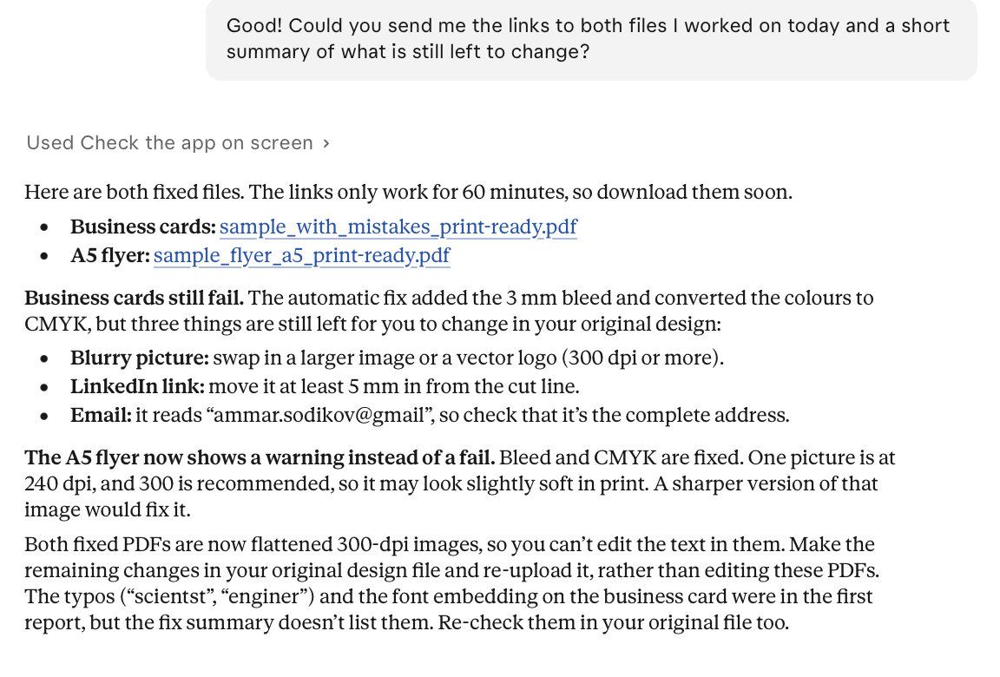
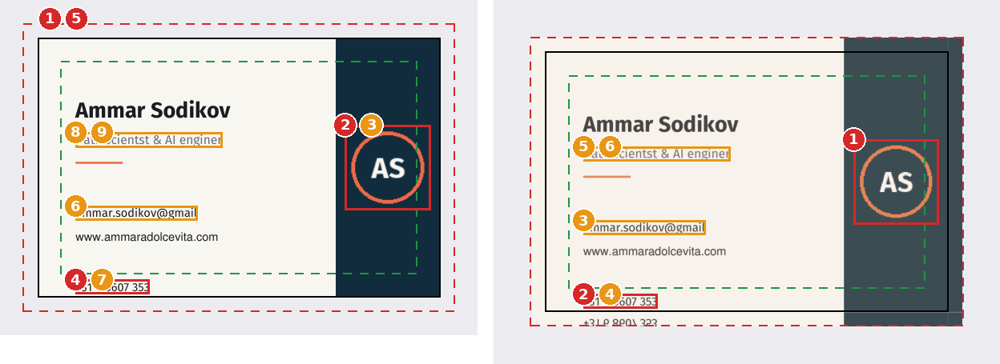

# 🖨️ Print Preflight

**Checks a print file before you order, in about a second, right inside Claude.** It shows what's wrong on the design, fixes what is safe to fix, and leaves the rest to the designer.

**[▶ Short video (under 2 minutes)](https://youtu.be/nXj7WTZwT0E)** · **Use it in Claude:** `https://print-preflight.onrender.com/mcp`

<table>
<tr>
<td width="50%"><br><b>1. Ask in plain words.</b> Claude opens the app in the chat; upload a file or pick a sample.</td>
<td width="50%"><br><b>2. Ask what it means.</b> The app measures, Claude explains: what one click fixes, what needs the designer.</td>
</tr>
<tr>
<td><br><b>3. Next product, same chat.</b> "Can I check my flyer too?" opens the app for an A5 flyer.</td>
<td><br><b>4. Everything in one place.</b> Links to both fixed files and an honest summary of what is still left.</td>
</tr>
</table>

> A demo prototype, built as a personal project. Not affiliated with any company, and it never places orders.

## Use it in Claude

1. In Claude (desktop or claude.ai in a browser): **Settings → Connectors → Add custom connector**.
2. URL: `https://print-preflight.onrender.com/mcp` (no sign-in).
3. In a new chat: *"I need 250 matte business cards. Can you check my design with Print Preflight?"*

A panel opens in the chat: upload a PDF/PNG/JPG or pick a sample, and you get the verdict, an interactive preview, one-click fixes and an order summary. Ask Claude anything about the result.
*Claude's mobile app does not show app panels yet; Team/Enterprise: an Owner adds connectors.*

## What's new in v0.2

v0.1 was a web app you visit. **v0.2 brings the same checks into the conversation**, where customers already ask AI assistants for help.

| | v0.1 | v0.2 (now) |
|---|---|---|
| Where | separate web page | **inside Claude**, as an [MCP App](https://modelcontextprotocol.io/docs/extensions/apps) (open standard, also in other assistants) |
| Getting the file in | upload on the page | upload in the chat, or pick a **sample** |
| Explaining problems | report + interactive preview | the same preview in the chat, and **Claude answers questions** in plain words |
| Fixing | fix button, typo suggestions to accept | the same in the chat; typo changes now **keep the font style** (serif stays serif) |
| Ordering | link to the product page | **order summary** from your own words ("250 matte business cards") |
| Languages | English | **English and Dutch**, following Claude's language |
| Real-world files | synthetic test set | **20 real-world-style files**; bugs found there (crop marks, rotated pages, Canva PNGs, links read as typos) fixed with tests |


*The automatic fix: bleed added and colours converted; what needs the designer stays listed.*

Full list: [CHANGELOG.md](CHANGELOG.md)

## How it works

```
Claude ──MCP──► hosted server ──► loader (PDF/PNG/JPG → one model in mm) ──► 8 checks ──► report
   │                │                                                          └──► fixes ──► re-check
   └── panel (MCP App) uploads, shows results, calls the same tools
```

- **Code measures, the AI explains.** Checks are deterministic Python (PyMuPDF, Pillow); Claude is the interface.
- **It never pretends.** What a fix cannot solve (blurry pictures, text at the edge, typos) is carried into the after-fix report.
- **Every print number has a source** in [`specs/print_specs.yaml`](specs/print_specs.yaml).

## How I know it works

- **42 synthetic files:** precision 1.00, recall 0.94. **20 real-world-style files** (Canva/Illustrator structures, crop marks, rotated pages, photos): 20/20 sensible verdicts, 0 crashes. → [eval/RESULTS.md](eval/RESULTS.md)
- **97 tests** + ruff in CI on every push.

## Run locally

```bash
git clone https://github.com/ammaradolcevita/print-preflight-agent && cd print-preflight-agent
pip install -e ".[dev,web,mcp]"
python -m preflight my_card.pdf --product business-card   # check a file
uvicorn mcp_server.http_app:app --port 8000               # hosted MCP server (/mcp)
python mcp_server/server.py                               # local MCP server for Claude Desktop (file paths)
streamlit run web/app.py                                  # web demo
pytest -q
```

## Limitations

- Online demo: business cards and A5/A6 flyers (flyers in beta). Files are deleted after 60 minutes.
- The automatic fix flattens pages to a 300-dpi image, so text is no longer editable; re-exporting with bleed is still best.
- CMYK conversion without the printer's ICC profile; colour checked on pictures and spot colours, not RGB vector shapes; no OCR for text in pictures.

MIT licence · Ammar Sodikov · [LinkedIn](https://www.linkedin.com/in/ammarsodikov/) · [GitHub](https://github.com/ammaradolcevita/print-preflight-agent)
