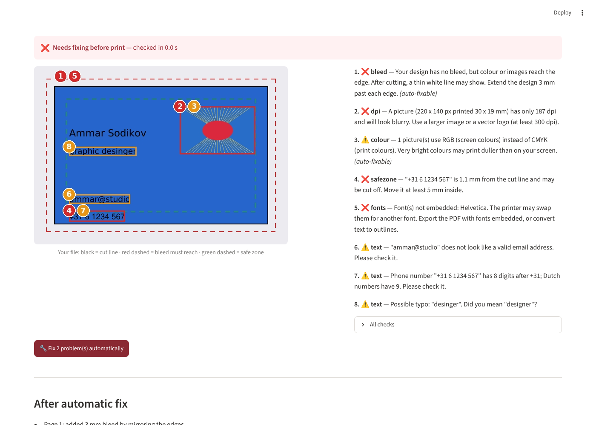

# 🖨️ Print Preflight Agent
**[▶ Try the live demo](https://print-preflight.streamlit.app)**

**Checks a print file before you order, in about 0.1 seconds.** It explains every problem in plain language, fixes what is safe to fix, and also works from inside an AI assistant (MCP).


*Left: a business card with nine problems. Right: after the one-click fix, bleed and colours are fixed, and what needs the designer is still listed. Black = cut line · red dashed = where bleed must reach · green dashed = safe zone.*

> Unofficial prototype built as a job application. Not affiliated with or endorsed by HelloPrint. It never places orders.

## The problem

In HelloPrint's cart (NL site, checked 18 Nov 2026):

- *"You can upload your files after placing your order."* The customer cannot check the file before buying.
- The file check is a paid add-on: *"Check my files. + €7.00. Did you know that our design experts still find errors in 40% of all files?"* On a €16.79 order of 250 business cards, that is 42% on top.

And on their public pages:
- the free **basic check** is an *"automated review of your artwork's resolution, size, and color settings"*;
- the expert check *"starts only once we have received your payment"*;
- *"we don't check grammar and spelling"*.

**If 40% of files have errors, an instant, free check before checkout is worth building.** A typo in an email address, or a phone number half cut off at the edge, on 500 business cards is exactly the mistake a customer notices too late.

Sources: [artwork check](https://www.helloprint.com/en-us/artwork-check) · [how long does an artwork check take](https://www.helloprint.com/en-ie/help-centre/how-long-does-an-artwork-check-take) · [always a perfect design](https://www.helloprint.com/en-ie/always-a-perfect-design) · [how to set up a file for print](https://www.helloprint.com/en-ie/blog/how-to-set-up-a-file-for-print) · cart text observed on helloprint.nl (English), 18 Nov 2026

## What it does

| Check | What it catches | Auto-fix |
|---|---|---|
| **size** | wrong page size or shape for the product (either orientation) | scale, if only the size differs |
| **bleed** | no bleed or too little, when colour reaches the edge (white edges are fine) | ✅ extend the edge colours outwards |
| **dpi** | pictures too low-resolution *at the size they are printed* | – (needs a better image) |
| **colour** | RGB pictures that may print duller | ✅ convert to CMYK |
| **safezone** | text closer than 3–5 mm to the cut line | – (designer's decision) |
| **fonts** | fonts not embedded in the PDF | ✅ fixed by flattening |
| **text** | **typos** (English + Dutch, names skipped), broken **email / web address / phone number** | ✅ typos: one-click *accept*, never automatic |
| **pages** | more pages than the product has sides | – |

Every number (3 mm bleed, 300 dpi and so on) lives in [`specs/print_specs.yaml`](specs/print_specs.yaml), with the source sentence. My own thresholds are marked `(ours)`.

There is also a small detail I noticed: HelloPrint's own pages give **two different safe margins (3 mm and 5 mm)**. Here, under 3 mm is an error and 3–5 mm is a warning.

## Results

**42 labelled files · precision 1.00 · recall 0.94 · about 65 ms per file.** The full write-up is in [eval/RESULTS.md](eval/RESULTS.md).

The evaluation earned its place. The first run showed **two false alarms**: a card with only 1–2 mm of bleed was called "the wrong shape". It was a size-check bug, and it is now fixed and covered by a regression test.

The two remaining misses are kept in the set on purpose, with the fix described:
- an RGB *vector* background (the colour check reads pictures only);
- a typo inside a picture (that needs OCR).

## Try it

```bash
git clone https://github.com/ammaradolcevita/print-preflight-agent && cd print-preflight-agent
pip install -e ".[dev,web,mcp]"

python -m preflight --list                                   # products
python -m preflight my_card.pdf --product business-card      # check a file
streamlit run web/app.py                                     # web demo (try the sample cards)
pytest -q                                                    # 36 tests
python eval/make_fixtures.py && python eval/run_eval.py      # evaluation
```



### From an AI assistant (MCP)

Add this to Claude Desktop's `claude_desktop_config.json`:

```json
{
  "mcpServers": {
    "print-preflight": {
      "command": "python",
      "args": ["/ABSOLUTE/PATH/print-preflight-agent/mcp_server/server.py"]
    }
  }
}
```

Then ask: *"I need 250 matte business cards. Can you check my design at ~/Desktop/card.pdf?"*

| Tool | Does |
|---|---|
| `find_product` | "250 matte business cards" → product, quantity 250, finish matte |
| `get_specs` | trim, bleed, safe margin, dpi, with sources |
| `check_artwork` | report + annotated preview image |
| `fix_artwork` | writes `*_print-ready.pdf` and re-checks it (the original is never changed) |
| `build_product_link` | public product page; no cart, no order |

## How it works

```
request ──► matcher ──► product specs (YAML, with sources)
file ─────► loader (PDF / PNG / JPG → one model in mm) ──► 8 checks ──► report ──► preview / web / MCP
                                                                          └──► fixes ──► re-check
```

**Code measures, the assistant explains.** All checks are deterministic Python (PyMuPDF, Pillow), so they cannot "hallucinate" a measurement. The language model is the interface: it understands the request and talks to the customer.

**Typos are suggested, never auto-corrected.** The customer ticks the corrections they want; only then the line is rewritten in the PDF (redaction + same position, size, colour and font). Contact details are never guessed.

**After a fix, it does not lie.** The fixed file is a flattened 300-dpi image, so a naive re-check would report "print-ready" even with a blurry logo and a typo. Problems an automatic fix cannot solve (dpi, safe zone, text) are carried over into the after-fix report.

## Limitations (honest)

- The evaluation files are synthetic and made by the same person who wrote the checks, so the scores are optimistic.
- The bleed fix flattens the page to a 300-dpi image: fine for print, but text is no longer editable. The best result is still re-exporting with bleed.
- The CMYK conversion uses MuPDF's colour management but not the printer's own ICC profile (e.g. FOGRA39). No overprint, spot-colour or total-ink checks yet.
- Colour is checked on pictures only, not on vector shapes.
- Text inside pictures is not read (no OCR yet).
- Spell-check: English and Dutch only, and capitalised words (names) are skipped.

## What I would do next

1. **Run it inside checkout**, before payment, next to the product configurator. Then measure the share of orders that need a manual artwork follow-up, before and after (A/B).
2. **Learn from real rejected files** (with permission) to rank the most common errors and tune the thresholds.
3. Add colour checks on vector shapes, OCR for text in pictures, and an ICC-based CMYK conversion.
4. Add a vision model for "is a face or logo cut off?", clearly labelled as an AI opinion.
5. Add a support-agent mode: paste a customer's file and get a ready reply in their language (NL/DE/FR/EN).

## Project layout

```
specs/print_specs.yaml   every print number, with its source
preflight/               loader, checks/, fixes, preview, matcher, report, CLI
mcp_server/server.py     MCP tools for AI assistants
web/app.py               Streamlit demo
eval/                    labelled fixtures, evaluation script, RESULTS.md
tests/                   pytest (36 tests)
```

MIT licence · Ammar Sodikov · [linkedin.com/in/ammarsodikov](https://www.linkedin.com/in/ammarsodikov/)
